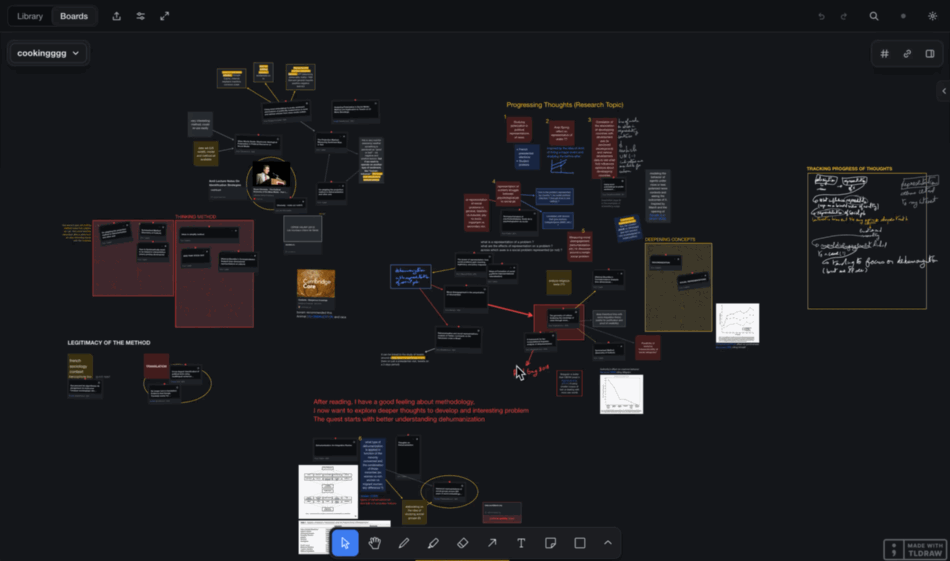
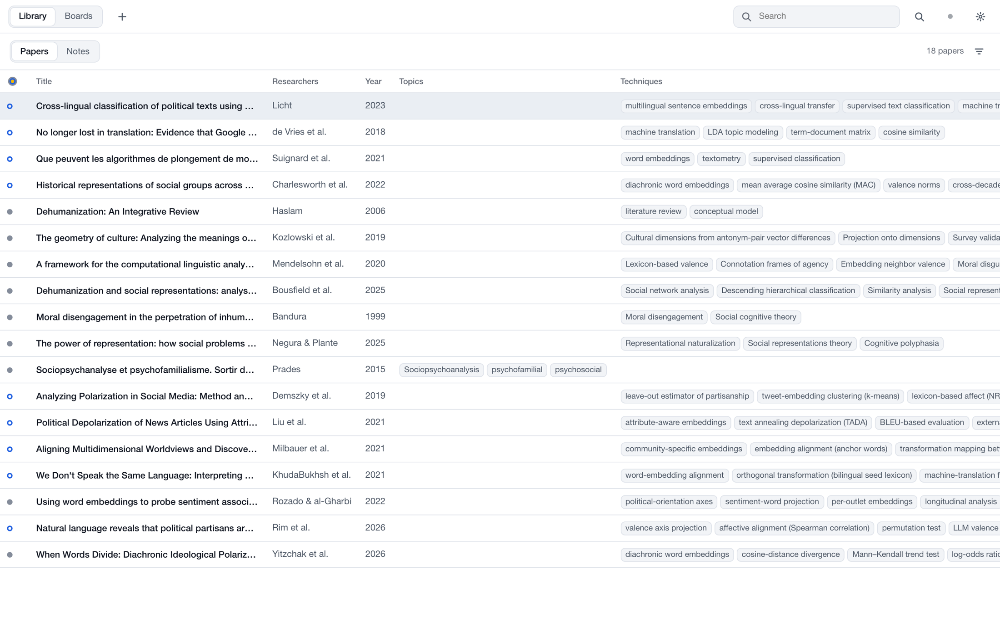
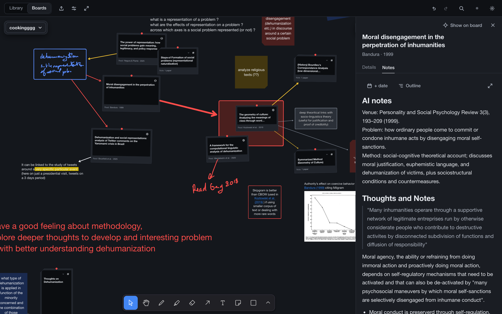
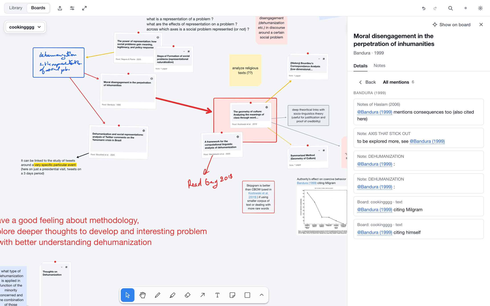

# Bubble Bath

**A research whiteboard where every paper is a live card.**
A paper library, a notebook and an infinite canvas in one app, built for Mac and iPad with Apple Pencil.

A real working board from my thesis, not a mock-up.

> **Status:** in active development. I ship new features and refinements most weeks, and the app is being tested behind the scenes with a small group of researchers to make it better and more accessible. The source code is private for now; this page is a preview.

## Why the name

A bubble bath lets a lot of bubbles form at once and still holds them in one clean, comfortable shape. That is what I want from a research tool: room for many ideas and perspectives to spark, inside a calm space that keeps them together.

## Why I built it

There are tools to **organize information** (Notion, Zotero, Obsidian) and tools to **think visually** (Figma, Miro, pen and paper). Research needs both at the same moment, and no software I tried does both.

I needed something that is a perfect fit for storing research papers and my thoughts about them, and that also lays them out visually: to draw links between them, to watch my thinking develop over time, and to draft ideas or gather resources without friction.

It is also a small act of **digital independence**. I don't want my research process to depend on big corporations and whatever their software allows this year. Building your own tool gives you full control over how you work, and the creative space to keep building on it.

## How it works

**1. Library.** A dense, keyboard-friendly table of papers with structured fields made for research: techniques, models, scale, open-source status, reading status and a "want to read" priority. Filter, sort and search across everything, including your notes.

**2. Boards.** Infinite whiteboards with pen, highlighter, arrows, sticky notes, frames and link previews for videos and web pages. Drag a paper from the library onto the canvas and it becomes a card that **references** the paper instead of copying it. Edit the paper anywhere and every card on every board updates at once.

**3. Notes.** Every paper has its own scratchpad for reading notes. Free-standing note cards hold the bigger thinking (a synthesis, a chapter outline, a comparison) and sit on the board next to the papers they are about.

## Everything links to everything

This is the part I like most. Type `@` anywhere you can write (a paper's notes, a note card, a sticky note, a label on an arrow) and pick a paper or a note. It becomes a **live reference**, not just text.

- **It stays true.** A reference shows as *Author et al. (year)* or the note's title, and the label follows the data. Fix a year or rename a note and every quote of it updates.
- **It works on the canvas too.** The same `@` picker works inside sticky notes and any text on a board, so handwriting, drawings and citations live side by side.
- **It builds the links for you.** Mention a paper inside a note and the two become linked, with no extra step.
- **It goes both ways.** Every paper has an **All mentions** list: each place it is quoted, with a snippet of the surrounding text. Click one and you land on that exact line or that exact spot on the board.
- **It finds things.** "Show on board" flies the canvas to a paper's card, and steps through them if the paper is pinned in several places.

The result is a web of thoughts you can walk in any direction: from a paper to every idea it fed, and from an idea back to its sources.

## What else it does

| | |
| --- | --- |
| **Live-linked cards** | One paper, many cards, across many boards. Always current. |
| **Apple Pencil first** | Pressure-sensitive ink; the Pencil draws while fingers pan and zoom. |
| **Rich notes** | Formatted editor with Markdown shortcuts, task lists, tables, pasted images and Mermaid diagrams. |
| **Works offline** | Local-first: every action is instant and never waits for the network. |
| **Quiet sync** | Mac and iPad stay in step in the background. No Save button anywhere. |
| **Your data stays yours** | Notes are stored as plain Markdown, and everything exports to one open JSON file. |
| **Focus mode** | Hide every control and leave only the board. |
| **Export** | Boards, frames or selections to PNG, SVG and PDF. |
| **Light and dark** | Follows the system. |

## Design

The interface stays out of the way so the research is the only thing with color. Everything is drawn in cool greys plus three primaries (red, yellow, blue), and color always carries meaning: reading status, or the ink you chose. Papers are flat, pinned polaroids. Controls are sized for a mouse on the Mac and for fingers on the iPad.

## Under the hood

- **React 19 + TypeScript**, built with Vite, installable as a **PWA** on Mac and iPad
- **tldraw** for the canvas, with custom card shapes
- **Dexie (IndexedDB)** as the local database, **Supabase (Postgres)** for sync between devices
- **TipTap** for the notes editor, with Markdown as the stored format
- Tested with unit tests and **Playwright** on desktop Chromium and iPad WebKit, including a two-device sync suite

## What's next

Ideas currently being explored: citation-manager integration (Zotero), PDF storage, and an optional AI reading assistant with privacy as the first constraint.

## Get in touch

If you do research and this is the tool you have been missing, or you would like to talk about it, write to me directly at [a.bennasr.000@gmail.com](mailto:a.bennasr.000@gmail.com) or [open an issue](../../issues).

---

© 2026. Preview only; the source code is not public. All rights reserved.
